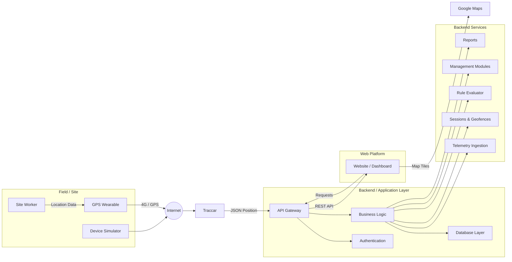
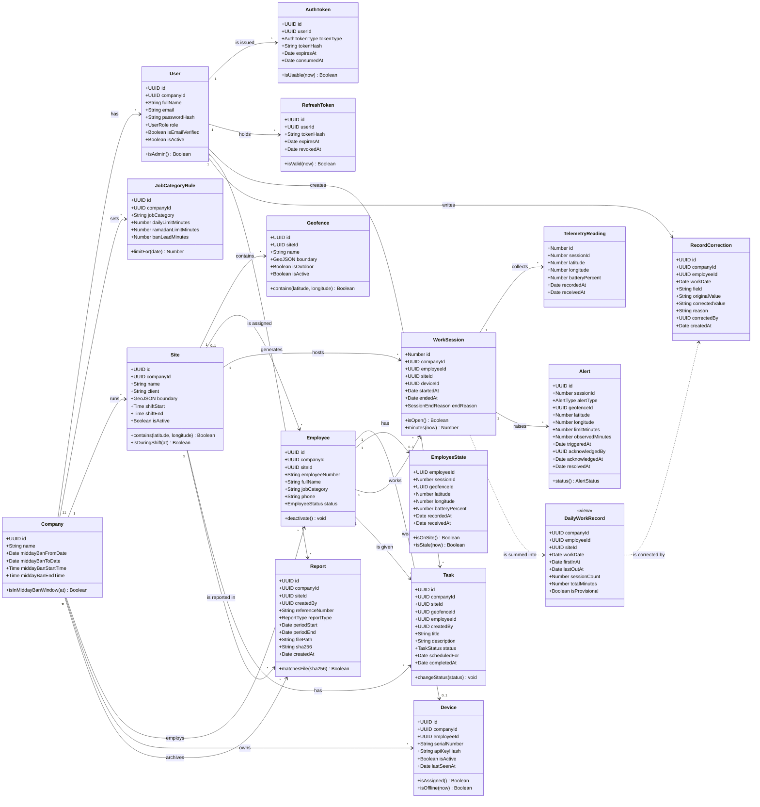
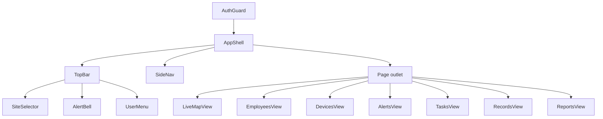
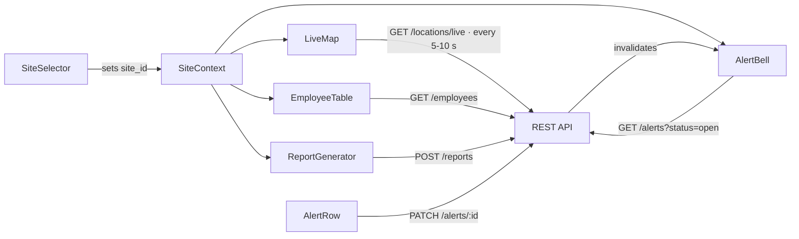
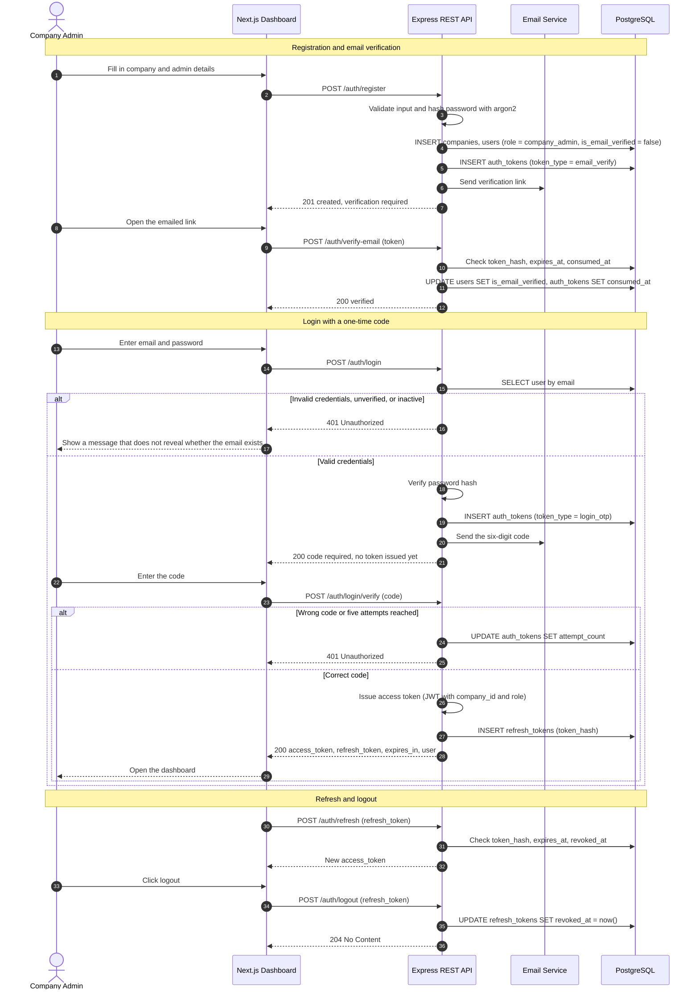
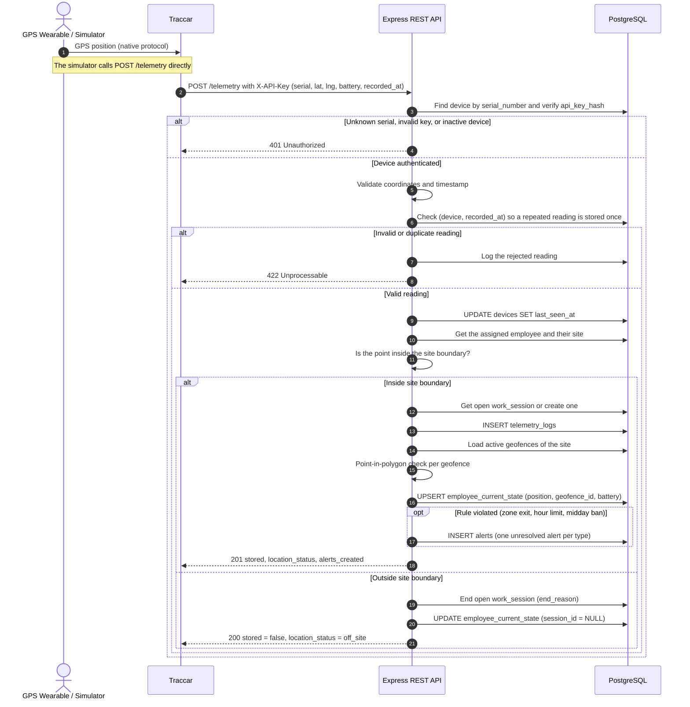
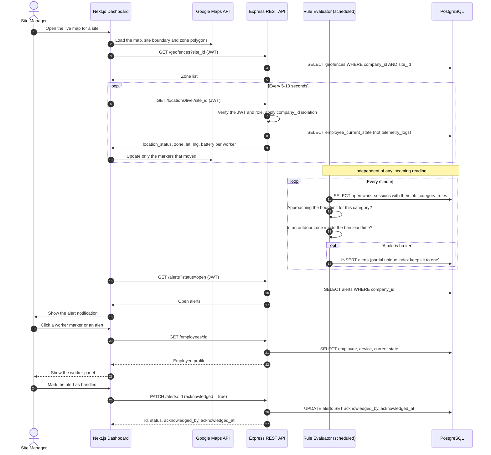
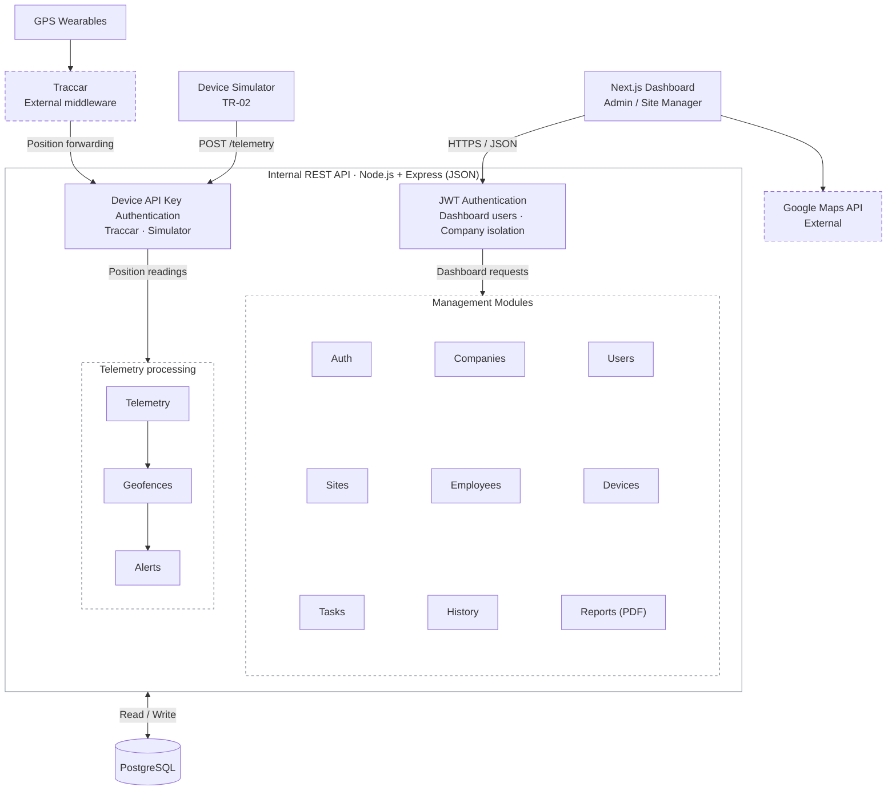

# Portfolio Project - Technical Documentation (Stage 3)
 
## Introduction
 
Stage 3 of the Portfolio Project is about turning the project's objectives and requirements into a detailed technical plan before development begins. In this stage we produce the **Technical Documentation**: the blueprint that defines what the system will do from the user's perspective, how it will be built, how its components will interact, and how we will manage and test our code.
 
The value of this stage is that it removes guesswork from development. It gives every team member a clear understanding of the system's architecture, data structures, and interfaces, so that frontend, backend, and IoT work can progress in parallel without conflicts. It also ensures that every technical decision is justified by our functional and non-functional requirements, reducing the risk of rework during the 6-week MVP.
 
This document builds on the scope defined in our [Project Charter](./Stage2.md).
 
## Table of Contents
- [0. Define User Stories and Mockups](#0-define-user-stories-and-mockups)
- [1. Design System Architecture](#1-design-system-architecture)
- [2. Define Components, Classes, and Database Design](#2-define-components-classes-and-database-design)
- [3. Create High-Level Sequence Diagrams](#3-create-high-level-sequence-diagrams)
- [4. Document External and Internal APIs](#4-document-external-and-internal-apis)
- [5. Plan SCM and QA Strategies](#5-plan-scm-and-qa-strategies)
- [6. Technical Justifications](#6-technical-justifications)
- [7. Authors](#7-authors)
---
 
## 0. Define User Stories and Mockups
 
Our team follows the Scrum methodology to manage development. Before writing user stories, we first establish a baseline of business and technical requirements. This ensures that every user story is traceable to a clear business need and a defined technical capability, and prevents the backlog from filling with features that fall outside our scope.
 
Our process is as follows:
 
1. **Business Requirements:** Define what the organization needs from the platform, based on the objectives in our Project Charter.
2. **Technical Requirements:** Translate those needs into functional and non-functional requirements the system must meet.
3. **User Types:** Identify who interacts with the system and in what role.
4. **User Stories:** Break the requirements into user stories written in the format "As a [user type], I want to [perform an action], so that [achieve a goal]."
5. **Prioritization:** Prioritize each story using the MoSCoW method: Must Have, Should Have, Could Have, and Won't Have.
6. **Mockups:** Design the main screens of the dashboard based on the prioritized stories.
### 0.1 Requirements and Users
 
One table holds the whole baseline: what the business needs (`BR`), what the system must do (`TR`), the quality targets it must meet (`NFR`), and who uses it (`UT`). Every item has an ID, so a design decision or a user story can cite the requirement it serves. **8 business requirements · 10 functional · 7 non-functional · 5 user types.**
 
| ID | Category | Requirement or role | Target, scope or detail |
|---|---|---|---|
| BR-01 | Business | Organizations must have a complete, automatic record of field operations: attendance, progress, movements, and alerts. | Delivered by IoT Data Integration, Live Map & Geofencing and History & Records |
| BR-02 | Business | Managers must be able to see where their workers are in real time on a site map. | Delivered by Live Map & Geofencing |
| BR-03 | Business | The system must alert managers early when a worker leaves a designated zone, exceeds the permitted working hours for their job category, or is in an outdoor zone as the midday work ban approaches. | Delivered by Automated Alerts |
| BR-04 | Business | Managers must be able to assign tasks to employees and follow their status. | Delivered by Task & Workload Assignment |
| BR-05 | Business | Organizations must be able to hand a client or an inspector a document, not a spreadsheet, and that document must be verifiable as the one we issued. | Delivered by Reports & Exports |
| BR-06 | Business | Each organization's data must remain private and accessible only to its own users. | Delivered by Company Account & Authentication |
| BR-07 | Business | An organization must be able to run several concurrent sites and attribute hours to the right project. | Delivered by Multiple Sites |
| TR-01 | Functional | The system must receive telemetry data — location, battery level, and timestamp — from IoT devices through a middleware server, Traccar. | Traccar and the telemetry ingestion module |
| TR-02 | Functional | The system must provide a device simulator that sends realistic telemetry data to the API without depending on hardware. "for testing" | Device simulator, posting to the telemetry endpoint directly |
| TR-03 | Functional | The backend must expose a RESTful API using JSON for all frontend operations, with one error shape and one validation layer. | 53 endpoints, Section 4.2 |
| TR-04 | Functional | The system must store companies, users, sites, employees, devices, geofences, work sessions, telemetry logs, alerts, tasks, corrections and reports in a relational database. | PostgreSQL: 16 tables and 1 view, Section 2.2 |
| TR-05 | Functional | The system must detect site entry and exit and geofence entry and exit by comparing each location reading with the defined boundaries. | Session and geofence engine, Section 1 |
| TR-06 | Functional | The system must evaluate its alert rules on a schedule as well as on arrival of a reading, so that a time-based rule fires even when no reading arrives. | Rule evaluator, running every minute |
| TR-07 | Functional | The dashboard must display worker locations on Google Maps and refresh positions automatically. | `LiveMap` component, Section 2.3 |
| TR-08 | Functional | The system must generate PDF reports server-side, each carrying a reference number and a SHA-256 fingerprint of the file. | Report service, `reports` table |
| TR-09 | Functional | Every query must be scoped to the signed-in company by shared middleware, and the telemetry endpoint must resolve the company from the device record and never from the request body. | JWT middleware; device API key authentication |
| TR-10 | Functional | Telemetry and alert records must be append-only at the database level; a correction must be stored as a new row that references the original. | Revoked `UPDATE` and `DELETE` on the application role; `record_corrections` table |
| NFR-01 | Non-functional | Performance | Map positions refresh every 5–10 seconds without freezing the dashboard, and the live response stays under 500 ms as history grows |
| NFR-02 | Non-functional | Alert speed | Alerts appear on the dashboard within 30 seconds of the triggering reading |
| NFR-03 | Non-functional | Security | Authentication on all private endpoints, hashed passwords, revocable refresh tokens, and HTTPS |
| NFR-04 | Non-functional | Data isolation | Users can only access data belonging to their own company |
| NFR-05 | Non-functional | Reliability | Incoming data is validated, invalid readings are rejected and logged, and a repeated reading is stored once |
| NFR-06 | Non-functional | Usability | Core actions reachable within 3 clicks from the main dashboard, with a 48px minimum touch target |
| NFR-07 | Non-functional | Integrity | Stored records cannot be updated or deleted by the application role |
| UT-01 | User type | Visitor | A potential client visiting the landing page |
| UT-02 | User type | Company Admin | Registers the company and manages its account, sites, employees, and devices |
| UT-03 | User type | Site Manager | Uses the dashboard daily to monitor workers, manage zones, assign tasks, and respond to alerts |
| UT-04 | User type | Worker | Wears the IoT device during shifts; does not use the dashboard and receives no communication through the device in the MVP |
| UT-05 | User type | Developer | Team member building and testing the system with simulated data |
 
The user stories below are our live Product Backlog, managed in Jira. Each story is identified in this document by its Jira key, so a story is looked up in Jira by the same identifier used here.
 
the backlog is organized into 11 epics:
 
| # | Epic | Key | Stories |
|---|---|---|---|
| 1 | Technical Foundation | `SITE-68` | 10 |
| 2 | Company Account & Authentication | `SITE-7` | 11 |
| 3 | Multiple Sites | `SITE-46` | 4 |
| 4 | Employee & Device Management | `SITE-8` | 7 |
| 5 | IoT Data Integration | `SITE-6` | 8 |
| 6 | Live Map & Geofencing | `SITE-9` | 7 |
| 7 | Automated Alerts | `SITE-11` | 7 |
| 8 | Task & Workload Assignment | `SITE-12` | 3 |
| 9 | History & Records | `SITE-13` | 6 |
| 10 | Reports & Exports | `SITE-45` | 5 |
| 11 | Landing Page | `SITE-15` | 2 |
 
### 0.2 Prioritized User Stories
 
70 stories, prioritized with MoSCoW, each row carrying the epic it belongs to. Within each priority band the order is the order we build in. **Must Have 37 · Should Have 23 · Could Have 10.**
 
The MVP scope was set in our Project Charter, so the Won't Have items are recorded there and no story in this backlog carries that priority.
 
| MoSCoW | Priority | Meaning we apply |
|---|---|---|
| Must Have | High | The final demo does not work without it |
| Should Have | Medium | The demo works, but the product is visibly incomplete |
| Could Have | Low | Dropped first if a week runs short |
| Won't Have | — | Out of scope; set in our Project Charter |
 
| Key | Epic | User Story | Priority |
|---|---|---|---|
| `SITE-74` | Technical Foundation | As a Developer, I want the whole stack to start with one command, so that nobody loses a day to a local setup problem. | Must Have |
| `SITE-69` | Technical Foundation | As a Developer, I want the whole schema as one runnable migration, so that every team member works against the same database from day one. | Must Have |
| `SITE-70` | Technical Foundation | As a Developer, I want one error shape and one validation layer across the API, so that the frontend handles failures the same way everywhere. | Must Have |
| `SITE-71` | Technical Foundation | As a Developer, I want the 33 endpoints written as a shared contract with a mock server behind it, so that the frontend is not blocked waiting for the backend. | Must Have |
| `SITE-72` | Technical Foundation | As a Developer, I want the app shell, routing and the auth guard in place, so that every feature screen is dropped into a frame that already works. | Must Have |
| `SITE-75` | Technical Foundation | As a Developer, I want one command that fills the database with a realistic company, so that every screen has something to show while it is being built. | Must Have |
| `SITE-76` | Technical Foundation | As a Developer, I want every pull request checked automatically, so that broken code never reaches the shared branch. | Must Have |
| `SITE-80` | Authentication | As a Developer, I want working access and refresh tokens with real revocation, so that logging out actually ends the session. | Must Have |
| `SITE-21` | Authentication | As a Company Admin, I want to register my company, so that my organization can start using the platform. | Must Have |
| `SITE-28` | Authentication | As a Company Admin, I want to log in and log out securely, so that only authorized people can access our data. | Must Have |
| `SITE-79` | Authentication | As a Developer, I want every query scoped to the signed-in company by shared middleware, so that no endpoint can leak another company's data by mistake. | Must Have |
| `SITE-32` | Authentication | As a Company Admin, I want my company's data to be visible only to my company's users, so that our operations stay private. | Must Have |
| `SITE-47` | Multiple Sites | As a Company Admin, I want to create a project site, so that work can be recorded against the right project. | Must Have |
| `SITE-48` | Multiple Sites | As a Company Admin, I want to run two or more concurrent sites, so that the platform matches how my company actually operates. | Must Have |
| `SITE-55` | Employee & Device | As a Company Admin, I want to create, view, edit and delete employee profiles, so that I can keep my workforce records up to date. | Must Have |
| `SITE-85` | Employee & Device | As a Company Admin, I want to upload my employee list as a file, so that I do not type two hundred workers by hand. | Must Have |
| `SITE-57` | Employee & Device | As a Company Admin, I want to register IoT devices in the system, so that they can be linked to employees. | Must Have |
| `SITE-58` | Employee & Device | As a Company Admin, I want to assign a device to an employee, so that incoming data is linked to the right person. | Must Have |
| `SITE-87` | IoT Integration | As a Developer, I want POST /telemetry to authenticate the device itself, so that nobody can push fake positions into a customer's record. | Must Have |
| `SITE-22` | IoT Integration | As the system, I want to receive location readings from IoT devices, so that worker activity is captured automatically. | Must Have |
| `SITE-88` | IoT Integration | As a Developer, I want repeated and excessive readings handled safely, so that a retrying device cannot corrupt the hours or flood the database. | Must Have |
| `SITE-23` | IoT Integration | As the system, I want every stored reading to carry both the device clock and the server clock, so that records stay accurate when a device clock drifts. | Must Have |
| `SITE-24` | IoT Integration | As a Developer, I want a simulator that sends realistic movement data, so that we can build and demo the system without depending on hardware. | Must Have |
| `SITE-49` | Multiple Sites | As a Company Admin, I want to assign employees to a site, so that their activity is attributed to the right project. | Must Have |
| `SITE-29` | Live Map | As a Site Manager, I want to draw work zones on the map, so that I can define where workers should be. | Must Have |
| `SITE-90` | Live Map | As a Developer, I want the session and zone engine built as one well-tested unit, so that hours and breaches are calculated the same way everywhere. | Must Have |
| `SITE-30` | Live Map | As the system, I want to know when a worker enters or leaves a zone, so that presence and breaches can be recorded. | Must Have |
| `SITE-91` | Live Map | As a Developer, I want the map reading one row per worker and the history tables indexed, so that the dashboard does not slow down as data grows. | Must Have |
| `SITE-27` | Live Map | As a Site Manager, I want to see all workers on a live map of my site, so that I know where my teams are in real time. | Must Have |
| `SITE-92` | Alerts | As a Developer, I want a timer that checks the rules independently of incoming readings, so that a warning fires on time even when nobody moves. | Must Have |
| `SITE-34` | Alerts | As a Site Manager, I want an alert when a worker leaves a designated zone, so that I can respond quickly. | Must Have |
| `SITE-35` | Alerts | As a Site Manager, I want a warning before the midday outdoor work ban begins, so that I can move crews before we are in violation. | Must Have |
| `SITE-93` | History & Records | As a Developer, I want the record protected by the database and not by convention, so that the exported report is worth something as evidence. | Must Have |
| `SITE-61` | History & Records | As a Company Admin, I want activity records that cannot be silently edited, so that our reports hold up as evidence. | Must Have |
| `SITE-62` | History & Records | As a Site Manager, I want each employee's daily record of attendance, hours, alerts and tasks, so that I have a reliable record for compliance. | Must Have |
| `SITE-94` | Reports | As a Developer, I want report generation to be one service that hashes what it produces, so that a client can prove the copy they hold is the one we issued. | Must Have |
| `SITE-51` | Reports | As a Company Admin, I want to generate a daily PDF report, so that I can hand our client or an inspector a document instead of a spreadsheet. | Must Have |
| `SITE-73` | Technical Foundation | As a Developer, I want the brand palette, type scale and spacing as Tailwind tokens, so that the UI is consistent without anyone picking colors by hand. | Should Have |
| `SITE-78` | Technical Foundation | As a Developer, I want merges to deploy themselves, so that the demo environment is always the current code. | Should Have |
| `SITE-77` | Technical Foundation | As a Developer, I want one automated test that walks the whole product, so that a broken demo is caught by CI and not on stage. | Should Have |
| `SITE-81` | Authentication | As a Company Admin, I want to confirm my email address, so that nobody can register a company using an address they do not own. | Should Have |
| `SITE-36` | Authentication | As a Company Admin, I want to add Site Manager accounts, so that my managers can use the dashboard. | Should Have |
| `SITE-82` | Authentication | As a Company Admin, I want my Site Managers to receive an invitation and set their own password, so that I never have to send credentials through WhatsApp. | Should Have |
| `SITE-50` | Multiple Sites | As a Site Manager, I want to switch between sites, so that I can supervise more than one project without logging out. | Should Have |
| `SITE-83` | Authentication | As a Company Admin, I want the dashboard to show me what to do first, so that I am not staring at an empty screen after registering. | Should Have |
| `SITE-86` | Employee & Device | As a Company Admin, I want to register a batch of device serials at once, so that ninety watches do not take ninety forms. | Should Have |
| `SITE-59` | Employee & Device | As a Site Manager, I want to view an employee's profile with their current status and device, so that I have all their information in one place. | Should Have |
| `SITE-25` | IoT Integration | As a Site Manager, I want to see when a device has stopped reporting, so that I know the record has a gap. | Should Have |
| `SITE-89` | IoT Integration | As a Developer, I want Traccar normalizing the hardware protocols, so that the backend does not depend on one vendor's data format. | Should Have |
| `SITE-31` | Live Map | As a Site Manager, I want to click a worker on the map to see their details, so that I can check their status without leaving the map. | Should Have |
| `SITE-37` | Alerts | As a Site Manager, I want an alert when a worker approaches the daily working-hour limit for their job category, so that I can rotate them before we are in violation. | Should Have |
| `SITE-38` | Alerts | As a Site Manager, I want a list of all alerts, so that I can review what happened during the day. | Should Have |
| `SITE-39` | Alerts | As a Site Manager, I want to mark an alert as handled, so that my team knows it has been addressed. | Should Have |
| `SITE-42` | Tasks | As a Site Manager, I want to create a task and assign it to an employee, so that everyone knows their responsibilities. | Should Have |
| `SITE-43` | Tasks | As a Site Manager, I want to mark a task complete, so that the daily record shows what was finished. | Should Have |
| `SITE-63` | History & Records | As a Site Manager, I want to view an employee's movement history for a selected day, so that I can review what happened on site. | Should Have |
| `SITE-52` | Reports | As a Company Admin, I want every report to carry a unique reference number, so that a client can confirm the copy they hold is the one we issued. | Should Have |
| `SITE-53` | Reports | As a Company Admin, I want hours broken down by project and zone, so that I can allocate labour cost across concurrent contracts. | Should Have |
| `SITE-66` | Landing Page | As a Visitor, I want to read about the platform on a landing page, so that I understand what it does before registering. | Should Have |
| `SITE-67` | Landing Page | As a Visitor, I want a clear button to register my company, so that I can start using the platform. | Should Have |
| `SITE-40` | Authentication | As a Company Admin, I want to reset my password, so that I can regain access if I forget it. | Could Have |
| `SITE-84` | Authentication | As a Company Admin, I want a one-time code as a second step at login, so that a stolen password alone does not open our data. | Could Have |
| `SITE-60` | Employee & Device | As a Company Admin, I want to search and filter employees, so that I can find a worker quickly on a list of two hundred. | Could Have |
| `SITE-26` | IoT Integration | As a Site Manager, I want to see a device's battery level, so that I can make sure devices are charged before a shift. | Could Have |
| `SITE-33` | Live Map | As a Site Manager, I want workers on the map colored by status, so that I can spot a problem at a glance. | Could Have |
| `SITE-41` | Alerts | As a Company Admin, I want to set hour limits and the ban lead time for each job category, so that alerts match how we actually work. | Could Have |
| `SITE-44` | Tasks | As a Site Manager, I want to see every task assigned to an employee, so that I can balance workloads. | Could Have |
| `SITE-64` | History & Records | As a Site Manager, I want to correct a record without erasing what was first recorded, so that the log stays credible. | Could Have |
| `SITE-54` | Reports | As a Company Admin, I want weekly and monthly reports, so that I can review a period rather than a single day. | Could Have |
| `SITE-65` | History & Records | As a Site Manager, I want to replay a worker's movements on the map, so that I can see their path during the day. | Could Have |
 
### 0.3 Mockups
 
The dashboard is a management tool. Its main surfaces are lists, forms and records, so the frame of every screen is the same: a fixed sidebar for navigation, and a top bar holding the site selector, the alert count and the user menu. The live map is one screen inside that frame, not the frame itself.
 
The screens are designed in Figma using the SITE14 design tokens: the palette, the Archivo Black and Inter type pairing, the 8px spacing scale and the 48px minimum touch target from our brand guidelines. Section 2.3 lists the components each screen is built from.
 
**Figma file:** [Figma link](https://www.figma.com/design/wr77QOIGkeNNuoNE4du1WD/work-site?node-id=0-1&t=wF7US94hhPVJgvCv-1)
 
| # | Screen | Frame size | Stories | Status |
|---|---|---|---|---|
| 1 | Dashboard: today's summary and the first-setup checklist | 1440 x 1024 | `SITE-83` | In progress |
| 2 | Employee list with search and filters | 1440 x 1024 | `SITE-55`, `SITE-60` | In progress |
| 3 | Employee profile with live status and day history | 1440 x 1024 | `SITE-59`, `SITE-63` | In progress |
| 4 | Employee import from CSV: upload, map columns, preview, confirm | 1440 x 1024 | `SITE-85` | In progress |
| 5 | Device list with assignment and battery | 1440 x 1024 | `SITE-57`, `SITE-58`, `SITE-26` | In progress |
| 6 | Alert list and acknowledgement | 1440 x 1024 | `SITE-38`, `SITE-39` | In progress |
| 7 | Task list and assignment form | 1440 x 1024 | `SITE-42`, `SITE-43` | In progress |
| 8 | Daily work record with corrections | 1440 x 1024 | `SITE-62`, `SITE-64` | In progress |
| 9 | Report generation and report list | 1440 x 1024 | `SITE-51`, `SITE-52` | In progress |
| 10 | Live map with the worker detail panel | 1440 x 1024 | `SITE-27`, `SITE-29`, `SITE-31` | In progress |
| 11 | Site list and site form with its boundary | 1440 x 1024 | `SITE-47`, `SITE-48` | In progress |
| 12 | Landing page | 1440 x 1024 | `SITE-66`, `SITE-67` | In progress |
| 13 | Login and one-time code | 393 x 852 | `SITE-28`, `SITE-84` | In progress |
| 14 | Settings: user accounts and the hour limits per job category | 1440 x 1024 | `SITE-36`, `SITE-82`, `SITE-41` | In progress |
| 15 | Employee list on a phone | 393 x 852 | `SITE-55`, `SITE-60` | In progress |
 
## 1. Design System Architecture
 
This section describes the high-level architecture of the system: the field devices, the internet, the Traccar middleware, the backend services, the database and the web dashboard.
 
### High-Level Architecture
 

 
### Architecture Components
 
#### 1. Field / Site
 
The field layer represents the physical environment where the site worker operates.
 
- **Site Worker** — Person being monitored by the system.
- **GPS Wearable** — Device responsible for collecting and transmitting location and battery level.
- **Device Simulator** — Sends realistic location data to the API so that development and the demo do not depend on hardware.
#### 2. Internet
 
The collected data is transmitted through the Internet to the backend infrastructure.
 
The system uses:
 
- GPS
- 4G / Cellular connectivity
#### 3. Traccar
 
Traccar is an open-source tracking server that receives the native protocols of the GPS wearables, normalizes them, and forwards each position to our API as JSON. The backend therefore does not depend on one vendor's data format. The simulator posts to the API directly and does not pass through Traccar.
 
#### 4. Backend / Application Layer
 
The backend is responsible for receiving, processing, validating, and storing the incoming data.
 
**API Gateway** — The main entry point for communication between clients and the backend. It receives requests, routes them, validates them, returns responses and talks to the backend services.
 
**Authentication** — Handles two kinds of caller: dashboard users with a JWT, and devices with an API key. It also applies the company scope to every request, so a user only ever reads their own company's data.
 
**Business Logic** — Contains the core application rules: work sessions, zones, alerts, working-hour limits, the midday ban window, tasks and sites.
 
**Database Layer** — Responsible for persistent storage: companies, users, sites, employees, devices, zones, work sessions, positions, alerts, tasks, corrections and reports.
 
#### 5. Backend Services
 
**Telemetry Ingestion** — Validates each reading, rejects implausible ones, and stores a repeated reading once.
 
**Sessions & Geofences** — Opens and closes a work session on the site boundary, and checks each position against the active zones.
 
**Rule Evaluator** — Runs on a timer over the open sessions and raises an alert when a working-hour limit or the midday ban window is reached, even when no reading arrives.
 
**Management Modules** — Sites, employees, devices, zones, tasks, history and user accounts: the operations the dashboard calls to create, read, update and deactivate records.
 
**Reports** — Produces the PDF, issues its reference number and stores the file's SHA-256 fingerprint.
 
#### 6. Web Platform
 
The website provides the dashboard for Company Admins and Site Managers. It is used to manage employees, devices, sites and zones, monitor live locations, handle alerts, assign tasks, review records and generate reports. It communicates with the backend through the API Gateway, and draws the map with the Google Maps JavaScript API.
 
### Data Flow
 
The general data flow is:
 
```text
Site Worker
     |
     v
GPS Wearable / Device Simulator
     |
     |-- Location
     |-- Battery Level
     |-- Timestamp
     |
     v
   Internet
     |
     v
   Traccar
     |
     v
 API Gateway
     |
     v
Business Logic
     |
     |-- Telemetry Ingestion
     |-- Sessions & Geofences
     |-- Rule Evaluator
     |-- Management Modules
     |-- Reports
     |
     v
  Database
     |
     v
Web Dashboard
```
 
Two points matter for the sections that follow. The live map reads `employee_current_state`, which holds one row per employee, and never the growing `telemetry_logs`, so it does not slow down as history grows. And a position is only stored inside a work session, so the system keeps a record of work and not of a person's whole day.
 
## 2. Define Components, Classes, and Database Design
 
### 2.1 Back-End Classes
 
The backend is organized around the domain classes below. Each class maps to a table in the database design in Section 2.2, and each is exposed through one or more API modules in Section 4. Methods hold the business rules the backend applies: site and zone containment, shift windows, offline detection, the working-hour limit of a job category, and the midday ban window.
 

 
| Class | Responsibility | API module (Section 4) |
|---|---|---|
| `Company` | Company record and its midday ban season and window | Auth (register) |
| `JobCategoryRule` | The working-hour limit and ban lead time of one job category, with its Ramadan value | Companies (rules) |
| `User` | Dashboard accounts and roles (`company_admin`, `site_manager`) | Auth, Users |
| `AuthToken` | Single-use, time-limited tokens for email verification, invitation, password reset and the login one-time code | Auth, Users |
| `RefreshToken` | A stored session token, so that logging out really revokes a session | Auth |
| `Site` | Site boundary and shift; checks whether a position is on site and within the shift | Sites |
| `Employee` | Worker profile, site assignment and job category, which sets their hour limit | Employees |
| `Device` | Wearable identity, API key and online status | Devices, Telemetry |
| `WorkSession` | A period an employee spends on site during the shift; positions are stored only inside one | Telemetry, History |
| `TelemetryReading` | A stored position reading (append-only) | Telemetry, History |
| `EmployeeState` | The latest known state of each employee, read by the live map | Live locations, Employees |
| `Geofence` | Work zone inside a site; checks whether a position is inside the zone | Geofences, Telemetry |
| `Alert` | Zone exit, working-hour and midday ban alerts raised by the rule evaluator | Alerts |
| `Task` | Task assigned to an employee, optionally in a zone | Tasks |
| `DailyWorkRecord` | Read-only view that sums an employee's work sessions per day | History, Reports |
| `RecordCorrection` | An appended correction to a daily record, carrying the original value, the reason and its author | History (corrections) |
| `Report` | Metadata of a generated PDF, including its reference number and SHA-256 fingerprint | Reports |
 
### 2.2 Database Design
 
The system uses a relational database, **PostgreSQL**. The schema is written as an executable migration and contains **16 tables and 1 view**.
 
#### Tables
 
| # | Table | Purpose |
|---|---|---|
| 1 | `companies` | The tenant: one row per client organization, with its midday ban season and window |
| 2 | `job_category_rules` | Working-hour limit, Ramadan limit and ban lead time per job category |
| 3 | `users` | Dashboard accounts: Company Admins and Site Managers |
| 4 | `auth_tokens` | Single-use tokens: email verification, invitation, password reset, login one-time code |
| 5 | `refresh_tokens` | Stored session tokens, so that logging out really revokes a session |
| 6 | `sites` | The project sites of a company: client, perimeter and planned shift |
| 7 | `employees` | The workers being tracked, their site and their job category |
| 8 | `devices` | Wearables, real or simulated, and the employee each one is assigned to |
| 9 | `geofences` | The work zones drawn inside a site, and whether each is outdoor |
| 10 | `work_sessions` | The attendance record: each continuous presence of a worker on a site |
| 11 | `telemetry_logs` | Every position that was stored; the movement history. Append-only |
| 12 | `alerts` | What the rule evaluator found, and how it was handled. Append-only |
| 13 | `employee_current_state` | The latest position of each employee; feeds the live map |
| 14 | `tasks` | Work given to one employee, on a site, for a day |
| 15 | `record_corrections` | Appended corrections to a daily record; the original value is never overwritten |
| 16 | `reports` | Generated PDF reports with their reference number and SHA-256 fingerprint |
| – | `daily_work_records` (view) | Minutes per worker, site and day, summed from the sessions |
 
#### Entity-Relationship Diagram

```mermaid
erDiagram
    companies ||--o{ users : "has"
    companies ||--o{ job_category_rules : "sets"
    companies ||--o{ sites : "runs"
    companies ||--o{ employees : "employs"
    companies ||--o{ devices : "owns"
    companies ||--o{ tasks : "plans"
    companies ||--o{ reports : "archives"
    companies ||--o{ record_corrections : "logs"
    users ||--o{ auth_tokens : "is issued"
    users ||--o{ refresh_tokens : "holds"
    users |o--o{ alerts : "acknowledges"
    users ||--o{ tasks : "creates"
    users ||--o{ reports : "generates"
    users ||--o{ record_corrections : "writes"
    sites |o--o{ employees : "is assigned"
    sites ||--o{ geofences : "contains"
    sites ||--o{ work_sessions : "hosts"
    sites ||--o{ tasks : "has"
    sites ||--o{ reports : "is reported in"
    employees |o--o| devices : "wears"
    employees ||--o{ work_sessions : "works"
    employees ||--o| employee_current_state : "has"
    employees ||--o{ tasks : "is given"
    employees ||--o{ record_corrections : "is corrected in"
    devices ||--o{ work_sessions : "records"
    geofences |o--o{ alerts : "is named in"
    geofences |o--o{ employee_current_state : "is the zone of"
    geofences |o--o{ tasks : "locates"
    work_sessions ||--o{ telemetry_logs : "collects"
    work_sessions ||--o{ alerts : "raises"
    work_sessions |o--o{ employee_current_state : "is open in"
 
    companies {
        uuid id PK
        varchar(150) name
        varchar(50) commercial_registration "nullable"
        date midday_ban_from_date "nullable; season start"
        date midday_ban_to_date "nullable; season end"
        time midday_ban_start_time "default 12:00"
        time midday_ban_end_time "default 15:00"
        timestamptz created_at
        timestamptz updated_at
    }
    job_category_rules {
        uuid id PK
        uuid company_id FK
        varchar(60) job_category "unique per company"
        smallint daily_limit_minutes "default 480 = 8 h"
        smallint ramadan_limit_minutes "nullable"
        smallint ban_lead_minutes "default 10"
        timestamptz created_at
        timestamptz updated_at
    }
    users {
        uuid id PK
        uuid company_id FK
        varchar(120) full_name
        varchar(255) email "unique, case-insensitive"
        varchar(255) password_hash "argon2; null until invitation accepted"
        user_role role
        boolean is_email_verified
        boolean is_active
        timestamptz created_at
        timestamptz updated_at
    }
    auth_tokens {
        uuid id PK
        uuid user_id FK
        auth_token_type token_type "email_verify, invitation, password_reset, login_otp"
        varchar(255) token_hash UK "SHA-256 digest"
        timestamptz expires_at
        timestamptz consumed_at "nullable; single use"
        smallint attempt_count "default 0; locks the otp"
        timestamptz created_at
    }
    refresh_tokens {
        uuid id PK
        uuid user_id FK
        varchar(255) token_hash UK "SHA-256 digest"
        timestamptz expires_at
        timestamptz revoked_at "nullable, set on logout"
        timestamptz created_at
    }
    sites {
        uuid id PK
        uuid company_id FK
        varchar(120) name "unique per company"
        varchar(150) client "nullable"
        jsonb boundary "GeoJSON Polygon, the perimeter"
        time shift_start "Saudi time"
        time shift_end "Saudi time"
        boolean is_active
        timestamptz created_at
        timestamptz updated_at
    }
    employees {
        uuid id PK
        uuid company_id FK
        uuid site_id FK "nullable = not assigned"
        varchar(30) employee_number "nullable, unique per company"
        varchar(120) full_name
        varchar(60) job_category "FK to job_category_rules per company"
        varchar(20) phone "nullable"
        employee_status status
        timestamptz created_at
        timestamptz updated_at
    }
    devices {
        uuid id PK
        uuid company_id FK
        uuid employee_id FK "nullable = unassigned; one device per employee"
        varchar(64) serial_number UK
        varchar(255) api_key_hash "SHA-256 digest"
        boolean is_active
        timestamptz last_seen_at "nullable, offline is computed"
        timestamptz created_at
    }
    geofences {
        uuid id PK
        uuid site_id FK
        varchar(120) name
        jsonb boundary "GeoJSON Polygon"
        boolean is_outdoor "the midday ban applies"
        boolean is_active
        timestamptz created_at
        timestamptz updated_at
    }
    work_sessions {
        bigserial id PK
        uuid company_id FK
        uuid employee_id FK
        uuid site_id FK
        uuid device_id FK "the device worn, snapshot"
        timestamptz started_at "device clock"
        timestamptz ended_at "nullable = still on site"
        session_end_reason end_reason "nullable; set when the session ends"
        timestamptz created_at "server clock"
    }
    telemetry_logs {
        bigserial id PK
        bigint session_id FK "no position without a session"
        double latitude
        double longitude
        smallint battery_percent "nullable"
        timestamptz recorded_at "device clock; unique per device"
        timestamptz received_at "server clock"
    }
    alerts {
        uuid id PK
        bigint session_id FK
        alert_type alert_type "zone_exit, hour_limit, midday_ban"
        uuid geofence_id FK "nullable; mandatory for midday_ban"
        double latitude "last position inside the site"
        double longitude
        integer limit_minutes "nullable; hour alerts only"
        integer observed_minutes "nullable; hour alerts only"
        timestamptz triggered_at "device clock"
        timestamptz created_at "server clock"
        uuid acknowledged_by FK "nullable; the user who saw it"
        timestamptz acknowledged_at "nullable"
        timestamptz resolved_at "nullable = still open"
    }
    employee_current_state {
        uuid employee_id PK "also FK to employees"
        bigint session_id FK "nullable = off site"
        uuid geofence_id FK "nullable = in no zone"
        double latitude "last position inside a site"
        double longitude
        smallint battery_percent "nullable"
        timestamptz recorded_at "device clock"
        timestamptz received_at "server clock"
    }
    tasks {
        uuid id PK
        uuid company_id FK
        uuid site_id FK
        uuid geofence_id FK "nullable; a zone of the same site"
        uuid employee_id FK "the worker it is given to"
        uuid created_by FK
        varchar(150) title
        text description "nullable"
        task_status status
        date scheduled_for "default today, Saudi time"
        timestamptz completed_at "nullable; set when done"
        timestamptz created_at
        timestamptz updated_at
    }
    record_corrections {
        uuid id PK
        uuid company_id FK
        uuid employee_id FK
        date work_date
        varchar(40) field "which value was corrected"
        text original_value "never overwritten"
        text corrected_value
        text reason "mandatory"
        uuid corrected_by FK
        timestamptz created_at
    }
    reports {
        uuid id PK
        uuid company_id FK
        uuid site_id FK
        uuid created_by FK
        varchar(40) reference_number UK "printed on every page"
        report_type report_type "daily, weekly, monthly"
        date period_start
        date period_end
        varchar(500) file_path
        char(64) sha256 "fingerprint of the issued file"
        timestamptz created_at
    }
```
 

 
`PK` = primary key, `FK` = foreign key, `UK` = unique. A column is mandatory unless it is marked *nullable*.
 
#### Key Design Decisions
 
1. **The work session is the center of the record.** `work_sessions` holds one row for each continuous presence of a worker on a site, so hours are a simple sum. Every position and every alert belongs to a session.
2. **The live state is separated from the history.** The live map reads `employee_current_state`, one row per employee updated in place, and never the growing `telemetry_logs`.
3. **Tenant isolation is part of the schema.** Tables owned by a company carry `company_id`, and composite foreign keys that include it make the database refuse a link between rows of two companies. The telemetry endpoint resolves the company from the device row, not from the request body.
4. **A position is stored only inside a work session.** A session opens only while the worker is inside a site boundary, so readings taken off site are not stored.
5. **The record is append-only.** The application role has `INSERT` and `SELECT` on `telemetry_logs` and `alerts`, and `UPDATE` and `DELETE` are revoked. A correction is a new row in `record_corrections` carrying the original value, the reason and its author.
6. **A repeated reading is stored once.** The pair of device and `recorded_at` is unique, so a device that retries after losing the network does not inflate the hours.
7. **At most one unresolved alert of each type per session.** A partial unique index guarantees it, so a worker who stays in a banned zone produces one alert and not hundreds.
8. **The hour limit comes from the job category.** `job_category_rules` holds the daily limit, the Ramadan limit and the ban lead time per company, so the rule is configuration and not a constant in the code.
9. **Records are deactivated, not deleted.** Foreign keys use `ON DELETE RESTRICT`, so anything that has history cannot be removed.
10. **Types follow the use.** Identifiers that appear in URLs are UUIDs, the two high-volume tables use `BIGSERIAL`, and all timestamps are `TIMESTAMPTZ`. Each reading carries both the device clock and the server clock, so a drifting device clock is visible.
### 2.3 Front-End Components
 
The front-end is a **Next.js** application written in **TypeScript** and styled with **Tailwind CSS**, using the SITE14 design tokens. It is organized in three layers: an application shell that every signed-in screen renders inside, feature components that implement one epic each, and shared primitives taken from the SITE14 UI kit. Every component reads and writes through the internal REST API defined in Section 4; the browser holds no business rules of its own.
 
#### 2.3.1 Routes
 
| Route | Access | Screen | Stories |
|---|---|---|---|
| `/` | Public | Landing page and call to action | SITE-66, SITE-67 |
| `/register` | Public | Company registration | SITE-21 |
| `/verify-email` | Public | Email verification result | SITE-81 |
| `/login` | Public | Sign in, then one-time code | SITE-28, SITE-84 |
| `/forgot-password`, `/reset-password` | Public | Password reset | SITE-40 |
| `/invite/:token` | Public | A Site Manager sets their own password | SITE-82 |
| `/dashboard` | Admin, Manager | First-setup checklist and daily summary | SITE-83 |
| `/map` | Admin, Manager | Live site map, zones, worker panel | SITE-27, SITE-29, SITE-31, SITE-33 |
| `/employees` | Admin, Manager | Employee list, search, CSV import | SITE-55, SITE-60, SITE-85 |
| `/employees/:id` | Admin, Manager | Profile, live status, day history, path replay | SITE-59, SITE-63, SITE-65 |
| `/devices` | Admin | Device register, bulk import, assignment | SITE-57, SITE-58, SITE-86, SITE-25, SITE-26 |
| `/alerts` | Admin, Manager | Alert list and acknowledgement | SITE-38, SITE-39 |
| `/tasks` | Admin, Manager | Task list and assignment | SITE-42, SITE-43, SITE-44 |
| `/records` | Admin, Manager | Daily work records and corrections | SITE-62, SITE-64 |
| `/reports` | Admin, Manager | Report generation and reference lookup | SITE-51, SITE-52, SITE-53, SITE-54 |
| `/sites` | Admin | Create and edit project sites | SITE-47, SITE-48 |
| `/settings/users` | Admin | Site Manager accounts and invitations | SITE-36, SITE-82 |
| `/settings/rules` | Admin | Hour limits and ban lead time per job category | SITE-41 |
 
#### 2.3.2 Component Tree
 

 
#### 2.3.3 Shell Components
 
| Component | Responsibility | API |
|---|---|---|
| `AuthGuard` | Blocks protected routes for signed-out users, returns them to the requested route after login, refreshes the access token silently on a 401, and signs out cleanly when the refresh fails | `POST /auth/refresh`, `POST /auth/logout` |
| `AppShell` | Page frame; provides `AuthContext` and `SiteContext` to every descendant | — |
| `SideNav` | Navigation, with admin-only items hidden for a Site Manager | — |
| `TopBar` | Holds the site selector, the alert bell and the user menu | — |
| `SiteSelector` | Sets the active site for the whole application and remembers the last choice | `GET /sites` |
| `AlertBell` | Unresolved-alert count, polled; opens `/alerts` | `GET /alerts?status=open` |
| `RoleGate` | Wrapper that renders its children only for a permitted role, so permissions are expressed once instead of repeated per button | — |
 
#### 2.3.4 Feature Components
 
| Component | Responsibility | API | Stories |
|---|---|---|---|
| `SetupChecklist` | Guides a new company through site, zone, employees, devices and assignment; each step links to its screen and ticks itself | `GET /sites`, `GET /employees`, `GET /devices` | SITE-83 |
| `LiveMap` | Google Maps canvas with the site boundary and zone polygons; polls worker positions and updates only markers that moved | `GET /locations/live`, `GET /geofences` | SITE-27 |
| `WorkerMarker` | One worker on the map, colored by status and paired with a text label so color is never the only signal | — | SITE-33 |
| `WorkerPanel` | Collapsible panel over the map showing the selected worker's status, zone, hours today and device state; a bottom sheet at phone width | `GET /employees/:id` | SITE-31, SITE-59 |
| `ZoneEditor` | Draws, edits and deactivates a zone polygon, and marks it outdoor | `POST /geofences`, `PATCH /geofences/:id`, `DELETE /geofences/:id` | SITE-29 |
| `EmployeeTable` | Paged employee list with search by name or worker number and filters by site, zone, category and status | `GET /employees` | SITE-55, SITE-60 |
| `EmployeeImportWizard` | Four steps — upload, map columns, preview with invalid rows named, confirm. Writes nothing until the preview is confirmed | `POST /employees/import` | SITE-85 |
| `DeviceTable` | Devices with assignment, online state and battery level | `GET /devices` | SITE-57, SITE-25, SITE-26 |
| `DeviceBulkRegister` | Pastes or uploads a serial list and offers the issued API keys for download once | `POST /devices/bulk` | SITE-86 |
| `DeviceAssignDialog` | Links a device to an employee, or unassigns it | `PATCH /devices/:id` | SITE-58 |
| `AlertList` | Alerts filtered by type, status, worker and date range | `GET /alerts` | SITE-38 |
| `AlertRow` | One alert with its type, worker, zone and time, and the acknowledge action | `PATCH /alerts/:id` | SITE-39 |
| `TaskTable`, `TaskForm` | Creates a task for a worker on a site, optionally in a zone, and updates its status | `POST /tasks`, `GET /tasks`, `PATCH /tasks/:id` | SITE-42, SITE-43, SITE-44 |
| `DailyRecordView` | A worker's day: first seen, last seen, minutes per zone, alerts and completed tasks, marked provisional while the day is open | `GET /employees/:id/daily-record` | SITE-62 |
| `CorrectionForm` | Appends a correction with a mandatory reason; shows the original value beside it and never replaces it | `POST /employees/:id/daily-record/corrections` | SITE-64 |
| `MovementTimeline` | Chronological entry and exit events for a chosen date, showing device-offline gaps explicitly | `GET /employees/:id/history` | SITE-63 |
| `PathReplay` | Timeline scrubber that redraws the stored path on the map | `GET /employees/:id/history` | SITE-65 |
| `ReportGenerator` | Requests a daily, weekly or monthly PDF for a site and period | `POST /reports` | SITE-51, SITE-54 |
| `ReportList` | Generated reports with their reference numbers and download links | `GET /reports`, `GET /reports/:id/download` | SITE-52 |
| `ZoneHoursBreakdown` | Hours attributed per project and zone for a period | `GET /reports` data | SITE-53 |
| `SiteForm` | Creates and edits a site with its boundary, client and shift window | `POST /sites`, `PATCH /sites/:id` | SITE-47, SITE-48 |
| `UserInviteForm` | Invites a Site Manager by email; the admin never chooses another person's password | `POST /users` | SITE-36, SITE-82 |
| `RuleSettingsForm` | Hour limits and ban lead time per job category | `PUT /companies/rules` | SITE-41 |
 
#### 2.3.5 Shared Primitives
 
Taken from the SITE14 UI kit and used by every feature component, so spacing, states and color are decided once.
 
| Primitive | Notes |
|---|---|
| `Button` | Primary, secondary and quiet variants; 48px minimum touch target |
| `TextField`, `Select`, `DateRangePicker` | Label, hint, error and disabled states |
| `StatusChip` | Semantic status as color **and** text: on site, in zone, off site, offline, alert |
| `Card`, `Tabs`, `Modal` | Containers; the modal traps focus and closes on Escape |
| `DataTable` | Sorting, paging, sticky header, horizontal scroll inside its own container |
| `EmptyState` | Explains what a screen is for and offers the action that fills it, used on every list |
| `Toast` | Result of a write, stating what happened rather than that something succeeded |
| `Spinner`, `SkeletonRow` | Loading states that hold the layout instead of collapsing it |
 
#### 2.3.6 State and Data Flow
 
State lives in two React contexts and in the server. There is no global store, because every screen's data belongs to the server and is re-fetched rather than mirrored.
 
| Store | Holds | Lifetime |
|---|---|---|
| `AuthContext` | The access token in memory, the signed-in user and their role | Until sign-out; the refresh token is an httpOnly cookie the browser script never reads |
| `SiteContext` | The active `site_id` | Remembered for the viewer between visits |
| Query cache | Server responses, keyed by endpoint and `site_id`; the live map and alert bell are polled, lists are fetched on demand | Invalidated by the write that affects them |
 

 
Three rules follow from this shape:
 
1. **The active site is a single source.** Changing it in `SiteSelector` re-fetches the map, the worker list, the alerts and the reports together, so no screen can show one site's data beside another's.
2. **A write invalidates what it affects.** Acknowledging an alert refreshes the bell count and the alert list rather than editing a local copy, so two managers working at once never see different numbers.
3. **The live map never reads the history.** It polls `GET /locations/live`, which serves one row per worker, so its response time does not change as `telemetry_logs` grows.
---
 
## 3. Create High-Level Sequence Diagrams
 
The purpose of this task is to show how the components interact for the critical use cases. We chose the three flows that carry the most risk: getting a user authenticated and scoped to their company, turning a device reading into a stored record and an alert, and serving the live map while a manager handles alerts.
 
### 3.1 Authentication and Session Management
 
Registration, email verification, login with a one-time code, token refresh and logout for a Company Admin.
 

 
### 3.2 IoT Telemetry Processing
 
How a device position is authenticated, validated, checked against the site and its zones, and stored.
 

 
### 3.3 Live Map, Scheduled Rules and Alert Handling
 
What a Site Manager's screen does, and how a time-based alert is raised without any reading arriving.
 

 
---
 
## 4. Document External and Internal APIs
 
This section defines how our platform communicates with the outside world. It lists the external APIs the system relies on and why each was chosen. It then specifies our own internal API: a RESTful API built with Node.js and Express that exchanges JSON. The dashboard and the telemetry sources, Traccar and the device simulator, use this API to reach the backend. Field names and types follow the database design in Section 2.
 

 
### 4.1 External APIs
 
| External API | Used by | Purpose in our system | Why we chose it |
|---|---|---|---|
| **Google Maps JavaScript API** | Dashboard (frontend) | Draws the live site map and worker markers (`SITE-27`, `SITE-31`, `SITE-33`), draws and displays site boundaries and work zones (`SITE-29`), and replays movement paths (`SITE-65`). | It has accurate, well-maintained coverage of Saudi Arabia including recent construction areas, clear documentation, and a free monthly usage allowance that is sufficient for an MVP. It supports markers, polygons and drawing tools, which is exactly what workers, sites and zones require (TR-07). |
| **Traccar** (open-source GPS tracking server) | Backend (ingestion) | Receives raw data from the GPS wearables over their native protocols, normalizes it, and forwards each position to our API as JSON. | Traccar supports hundreds of GPS protocols and device models, so our backend does not depend on one vendor's data format. This is the mitigation for the *System-Device Mismatch* risk identified in our Project Charter: if the hardware we obtain speaks an unexpected protocol, the change is a Traccar configuration rather than a backend rewrite. It is open source, self-hosted, and has built-in HTTP position forwarding. |
| **Transactional email** (SMTP provider) | Backend | Sends email verification, Site Manager invitations, password resets and the login one-time code (`SITE-81`, `SITE-82`, `SITE-40`, `SITE-84`). | These four flows all need a delivered message and none of them need SMS. Email avoids the paid provider and the Saudi sender-ID registration that SMS would require, neither of which is justified inside a 6-week MVP. |
 
### 4.2 Internal API Endpoints
 
All paths are relative to the base URL `/api/v1`. **53 endpoints.**
 
**Access:** `Public` = no token · `Admin` = company_admin · `Manager` = site_manager, and an Admin can do everything a Manager can · `Device` = device API key in the `X-API-Key` header.
 
Every response that fails carries the same body shape: `{ error: { code, message, fields? } }` (TR-03). Every authenticated query is scoped to the caller's `company_id` by shared middleware (TR-09).
 
#### Authentication
 
| # | Method | Endpoint | Purpose | Access | Input | Output |
|---|---|---|---|---|---|---|
| 1 | POST | `/auth/register` | Register a company and its admin account | Public | `{ company_name, commercial_registration?, full_name, email, password }` | `{ user, company, verification_required: true }` |
| 2 | POST | `/auth/verify-email` | Confirm the admin's email address | Public | `{ token }` | `{ verified: true }` |
| 3 | POST | `/auth/verify-email/resend` | Send a new verification link | Public | `{ email }` | `204` (no body) |
| 4 | POST | `/auth/login` | Check credentials and send a one-time code | Public | `{ email, password }` | `{ code_required: true, expires_in }` |
| 5 | POST | `/auth/login/verify` | Exchange the one-time code for tokens | Public | `{ email, code }` | `{ access_token, refresh_token, expires_in, user }` |
| 6 | POST | `/auth/refresh` | Get a new access token | Public (refresh token) | `{ refresh_token }` | `{ access_token, expires_in }` |
| 7 | POST | `/auth/logout` | Revoke the refresh token | Admin, Manager | `{ refresh_token }` | `204` (no body) |
| 8 | POST | `/auth/forgot-password` | Request a password reset link | Public | `{ email }` | `204` (no body) |
| 9 | POST | `/auth/reset-password` | Set a new password with the emailed token | Public | `{ token, password }` | `{ reset: true }` |
 
#### Company and Users
 
| # | Method | Endpoint | Purpose | Access | Input | Output |
|---|---|---|---|---|---|---|
| 10 | GET | `/companies/me` | The company record and its ban season settings | Admin, Manager | — | `{ id, name, midday_ban_from_date, midday_ban_to_date, midday_ban_start_time, midday_ban_end_time }` |
| 11 | PATCH | `/companies/me` | Update the ban season and window | Admin | `{ midday_ban_from_date?, midday_ban_to_date?, midday_ban_start_time?, midday_ban_end_time? }` | Updated company |
| 12 | GET | `/companies/rules` | Hour limits per job category | Admin, Manager | — | `{ data: [{ job_category, daily_limit_minutes, ramadan_limit_minutes, ban_lead_minutes }] }` |
| 13 | PUT | `/companies/rules` | Set the hour limits per job category | Admin | `{ rules: [{ job_category, daily_limit_minutes, ramadan_limit_minutes?, ban_lead_minutes }] }` | `{ data: [rule] }` |
| 14 | POST | `/users` | Invite a Site Manager by email; no password is chosen by the admin | Admin | `{ full_name, email, role }` | `{ id, full_name, email, role, is_active: false, invited_at }` |
| 15 | GET | `/users` | List the company's user accounts | Admin | `?is_active` | `{ data: [user] }` |
| 16 | POST | `/users/:id/invitation/resend` | Send the invitation again | Admin | — | `204` (no body) |
| 17 | POST | `/invitations/:token/accept` | The invited manager sets their own password | Public | `{ password }` | `{ access_token, refresh_token, user }` |
| 18 | DELETE | `/users/:id` | Deactivate a user account | Admin | — | `204` (no body) |
 
#### Sites
 
| # | Method | Endpoint | Purpose | Access | Input | Output |
|---|---|---|---|---|---|---|
| 19 | POST | `/sites` | Create a project site with its boundary and shift | Admin | `{ name, client?, boundary, shift_start, shift_end }` | `{ id, name, client, boundary, shift_start, shift_end, is_active }` |
| 20 | GET | `/sites` | List the company's sites with worker counts | Admin, Manager | `?is_active` | `{ data: [{ id, name, client, employee_count, on_site_count }] }` |
| 21 | PATCH | `/sites/:id` | Update a site | Admin | `{ name?, client?, boundary?, shift_start?, shift_end? }` | Updated site |
| 22 | DELETE | `/sites/:id` | Deactivate a site; blocked if it has activity | Admin | — | `204` (no body) |
 
#### Employees
 
| # | Method | Endpoint | Purpose | Access | Input | Output |
|---|---|---|---|---|---|---|
| 23 | POST | `/employees` | Create an employee profile | Admin | `{ full_name, employee_number?, job_category, phone?, site_id? }` | `{ id, full_name, job_category, site_id, status }` |
| 24 | GET | `/employees` | List, search and filter employees | Admin, Manager | `?search, site_id, geofence_id, job_category, status, page, limit` | `{ data: [employee], page, limit, total }` |
| 25 | GET | `/employees/:id` | Profile with live status and device | Admin, Manager | — | `{ id, full_name, job_category, site, device, current_state, minutes_today }` |
| 26 | PATCH | `/employees/:id` | Edit a profile or reassign the site | Admin | Any field of #23 | Updated employee |
| 27 | DELETE | `/employees/:id` | Deactivate an employee; records are kept | Admin | — | `204` (no body) |
| 28 | POST | `/employees/import/preview` | Validate an uploaded CSV without writing | Admin | `multipart/form-data` file + `{ column_map }` | `{ valid_rows, invalid_rows: [{ row, reason }], duplicates: [row] }` |
| 29 | POST | `/employees/import` | Commit a previewed import | Admin | `{ import_id }` | `{ created, skipped, errors: [{ row, reason }] }` |
| 30 | GET | `/employees/import/template` | Download the CSV template with the exact headers | Admin | — | CSV file (`text/csv`) |
 
#### Devices and Telemetry
 
| # | Method | Endpoint | Purpose | Access | Input | Output |
|---|---|---|---|---|---|---|
| 31 | POST | `/devices` | Register one device and issue its API key | Admin | `{ serial_number }` | `{ id, serial_number, is_active, api_key }` — the key is returned once |
| 32 | POST | `/devices/bulk` | Register many devices from a serial list | Admin | `{ serial_numbers: [string] }` | `{ created: [{ serial_number, api_key }], skipped: [{ serial_number, reason }] }` |
| 33 | GET | `/devices` | List devices with assignment, online state and battery | Admin, Manager | `?site_id, online, assigned` | `{ data: [{ id, serial_number, employee, online, battery_percent, last_seen_at }] }` |
| 34 | PATCH | `/devices/:id` | Assign or unassign a device | Admin | `{ employee_id }` or `{ employee_id: null }` | Updated device |
| 35 | DELETE | `/devices/:id` | Deactivate a device | Admin | — | `204` (no body) |
| 36 | POST | `/telemetry` | Receive a position reading | Device | Header `X-API-Key` + `{ serial_number, latitude, longitude, battery_percent?, recorded_at }` | `{ id, session_id, stored, duplicate, location_status, alerts_created }` |
| 37 | GET | `/locations/live` | Current state of each worker, for the live map | Admin, Manager | `?site_id` | `{ site_id, data: [{ employee_id, full_name, location_status, zone, latitude, longitude, battery_percent, recorded_at }] }` |
 
#### Geofences
 
| # | Method | Endpoint | Purpose | Access | Input | Output |
|---|---|---|---|---|---|---|
| 38 | POST | `/geofences` | Create a work zone | Admin, Manager | `{ site_id, name, is_outdoor, boundary }` | `{ id, site_id, name, is_outdoor, boundary, is_active }` |
| 39 | GET | `/geofences` | List the work zones of a site | Admin, Manager | `?site_id, is_active` | `{ data: [geofence] }` |
| 40 | PATCH | `/geofences/:id` | Update a work zone | Admin, Manager | `{ name?, is_outdoor?, boundary? }` | Updated geofence |
| 41 | DELETE | `/geofences/:id` | Deactivate a work zone | Admin, Manager | — | `204` (no body) |
 
#### Alerts and Tasks
 
| # | Method | Endpoint | Purpose | Access | Input | Output |
|---|---|---|---|---|---|---|
| 42 | GET | `/alerts` | List alerts with filters | Admin, Manager | `?site_id, employee_id, type, status, from, to, page, limit` | `{ data: [{ id, type, status, employee, zone, limit_minutes, observed_minutes, triggered_at }], total }` |
| 43 | PATCH | `/alerts/:id` | Acknowledge an alert | Admin, Manager | `{ acknowledged: true }` | `{ id, status, acknowledged_by, acknowledged_at }` |
| 44 | POST | `/tasks` | Create a task and assign it to an employee | Admin, Manager | `{ title, description?, employee_id, site_id, geofence_id?, scheduled_for? }` | `{ id, title, employee_id, site_id, status: "pending" }` |
| 45 | GET | `/tasks` | List tasks, for example all tasks of one employee | Admin, Manager | `?employee_id, site_id, status, scheduled_for` | `{ data: [task] }` |
| 46 | PATCH | `/tasks/:id` | Update a task's status | Admin, Manager | `{ status }` | `{ id, status, completed_at }` |
 
#### History, Records and Reports
 
| # | Method | Endpoint | Purpose | Access | Input | Output |
|---|---|---|---|---|---|---|
| 47 | GET | `/employees/:id/history` | Movement history for one day, with offline gaps marked | Admin, Manager | `?date` | `{ employee_id, date, sessions: [{ session_id, started_at, ended_at, points, gaps }] }` |
| 48 | GET | `/employees/:id/daily-record` | Daily record: attendance, minutes per zone, alerts, tasks | Admin, Manager | `?date` | `{ employee_id, date, is_provisional, attendance, minutes_by_zone, alerts, tasks, corrections }` |
| 49 | POST | `/employees/:id/daily-record/corrections` | Append a correction with a mandatory reason | Admin, Manager | `{ date, field, corrected_value, reason }` | `{ id, field, original_value, corrected_value, reason, corrected_by, created_at }` |
| 50 | POST | `/reports` | Generate a PDF report with a reference number | Admin, Manager | `{ report_type, site_id, period_start, period_end? }` | `{ id, reference_number, period_start, period_end, sha256, download_url }` |
| 51 | GET | `/reports` | List generated reports | Admin, Manager | `?site_id, report_type, from, to, page, limit` | `{ data: [{ id, reference_number, report_type, period_start, period_end, created_by, created_at }], total }` |
| 52 | GET | `/reports/:id/download` | Download a generated PDF | Admin, Manager | — | PDF file (`application/pdf`) |
| 53 | GET | `/reports/verify` | Look up a reference number and check a file's fingerprint | Admin, Manager | `?reference_number, sha256?` | `{ reference_number, issued_by, created_at, period_start, period_end, matches }` |
 
---
 
## 5. Plan SCM and QA Strategies
 
### 5.1 Software Configuration Management with Jira Integration
 
#### 5.1.0 Jira Integration Overview
 
* **Tool:** Jira Software project **`SITE`**, connected to GitHub through the **GitHub for Jira** app, so branches, commits, pull requests, builds and deployments appear on each Jira issue's *Development* panel.
* **Single source of truth:** Every unit of work — story, task, bug, hotfix — exists as a Jira issue with a key such as `SITE-123`. No branch, commit or pull request is created without an issue key.
* **Issue types:** `Epic` → `Story` → `Sub-task`, plus `Bug` for defects.
* **Planning:** The product backlog is ranked in build order, and the work is planned as **six one-week iterations** from 11 October to 21 November 2026. Each epic and each story carries a due date and an owner.
| Jira Status | Triggered by | Automation rule |
|---|---|---|
| `To Do` | Issue created and pulled into the current week | — |
| `In Dev` | First branch containing the issue key is created | Auto-transition on the GitHub branch-created event |
| `In Review` | Pull request opened against `develop` | Auto-transition; reviewer notified |
| `In QA` | Pull request merged into `develop` and the staging deployment succeeds | Auto-transition on the GitHub deployment-success event |
| `UAT` | QA verification on staging passes | Manual transition by the QA lead; Jira Automation notifies the product owner to accept the story |
| `Done` | Release merged into `main` and the production deployment succeeds | Auto-transition; fix version stamped on the issue |
`UAT` is the one transition we do not automate, because acceptance is a judgement rather than an event: a feature can pass every test and still not be what the story asked for. Section 5.2.5 defines who accepts and against what.
 
#### 5.1.1 Version Control and Repository Management
 
* **Tool:** Git hosted on GitHub, linked to the Jira project.
* **Repository architecture:** A single **mono-repository** with `/frontend` for the Next.js application and `/backend` for the Express API. One repository keeps the API contract, the shared TypeScript types generated from it, and the Docker Compose file in one place, so a change to the contract and the two sides that consume it travel in one pull request. With four developers over six weeks, the coordination cost of two repositories is not justified.
* **Access control:** `main` and `develop` are protected. Direct pushes are disabled, and merging requires passing CI checks and one approving review.
* **Jira enforcement:** A branch-name and pull-request-title check in GitHub Actions fails if no valid `SITE-` issue key is present.
#### 5.1.2 Branching Strategy (GitFlow)
 
Branch names must include the Jira issue key: `<type>/<SITE-KEY>-<short-description>`.
 
| Branch type | Base | Target | Jira link | Purpose and rules |
|---|---|---|---|---|
| `main` | — | — | Release / Fix Version | Production-ready code. Direct pushes disabled. Deploys to production. |
| `develop` | `main` | `main` | Weekly iteration | Integration branch. Deploys automatically to staging. |
| `feature/*` | `develop` | `develop` | Story / Sub-task | Short-lived branch per issue, e.g. `feature/SITE-69-initial-migration`. |
| `bugfix/*` | `develop` | `develop` | Bug | Non-critical fixes found in staging or integration testing, e.g. `bugfix/SITE-210-session-close-reason`. |
| `hotfix/*` | `main` | `main` and `develop` | Bug (P0 / P1) | Emergency production fixes, e.g. `hotfix/SITE-301-login-outage`. Merged into both. |
 
#### 5.1.3 Commit Standards
 
All commits follow the **Conventional Commits** standard with the Jira key in the summary: `<type>(<scope>): <SITE-KEY> <short summary>`.
 
* **Types:** `feat` a new feature or API route · `fix` a defect in a controller, component or query · `docs` documentation · `style` formatting with no logic change · `refactor` restructuring without behavior change · `test` Jest or Supertest suites · `chore` Dockerfiles, dependencies, CI.
* **Examples:**
  * `feat(api): SITE-80 issue and revoke JWT access and refresh tokens`
  * `fix(ui): SITE-27 stop re-rendering map markers that have not moved`
  * `chore(docker): SITE-74 add the postgres service and env template`
* **Smart commits:** A message may include Jira commands such as `SITE-80 #comment token revocation added #time 2h`, which post a comment and log work on the issue.
* **Enforcement:** A `commit-msg` husky hook plus `commitlint` validates both the Conventional Commits format and the presence of a `SITE-` key.
#### 5.1.4 Code Review and Pull Request Workflow
 
1. **Creation.** A developer opens a pull request against `develop` from a `feature/*` branch. The title starts with the Jira key, for example `SITE-80: issue and revoke JWT tokens`, and the template requires the Jira link, a description and a test summary. The pull request appears on the Jira issue automatically, which moves it to `In Review`.
2. **Automated checks.** GitHub Actions runs ESLint, the TypeScript build, and the unit and integration suites across both the Express and Next.js projects. Results are reported back to the Jira issue.
3. **Peer review.** At least **one approving review** is required, assessing readability, the company scope on every query, database query efficiency, and unnecessary re-renders on the frontend. Because an unscoped query is a data breach rather than a bug, the reviewer checks the company scope on every new endpoint explicitly.
4. **Merge.** Approved pull requests are merged with **squash and merge** to keep a linear, auditable history. The squashed commit keeps the Jira key, and a successful staging deployment moves the issue to `In QA`. Once QA verification passes, the QA lead moves it to `UAT` for acceptance.
#### 5.1.5 Release Management
 
* Each release is a Jira **Version**, for example `v0.6.0`, with issues assigned through the *Fix Version* field.
* Release notes are generated from the version's resolved issues and attached to the GitHub Release created from the `main` tag.
* Production deployments are reported to Jira's **Deployments** feature, giving traceability from issue to pull request to build to environment.
---
 
### 5.2 Quality Assurance Strategy and Pipeline
 
#### 5.2.1 Testing Strategy
 
```text
       [ End-to-End (E2E) ]     -> One critical journey, end to end (Playwright)
      [ Integration Testing ]   -> API routes against a real PostgreSQL container (Supertest + Jest)
     [     Unit Testing     ]   -> Rule engine, middleware, React components (Jest + RTL)
    [ Static Code Analysis  ]   -> ESLint, Prettier, TypeScript
```
 
* **Static analysis.** ESLint and Prettier run on a pre-commit husky hook, and the TypeScript build must pass in CI. A lint rule rejects a raw hex color in a component, so the design tokens stay the single source of color.
* **Unit testing.** The session and geofence engine is the most heavily tested unit in the system, with cases for a point inside, outside, exactly on a boundary, and oscillating across one, because an error here corrupts hours, alerts and reports together. On the frontend, React Testing Library and Jest cover component rendering, state changes and custom hooks.
* **Integration testing.** Supertest issues HTTP requests against live Express routes connected to an isolated **PostgreSQL Docker container**, verifying queries, JSON shapes and status codes. Two cases are mandatory on every list and detail endpoint: a request from company A for a resource of company B must return 404, and a query written without the company scope must fail the suite.
* **End-to-end testing.** **Playwright** runs one automated journey covering the whole product: register a company, verify the email, log in, create a site, draw a zone, add employees, register and assign a device, let the simulator push a boundary breach, see the alert appear, open the daily record, and generate the report. The suite is written as a skeleton in week 1 and filled in as each feature lands, so it is never work left for the final week.
* **Jira traceability.** Test cases are linked to their story with the `is tested by` issue link. The acceptance criteria written on each story become the E2E assertions. CI results are posted to the issue's Development panel.
#### 5.2.2 QA Tools
 
| Category | Tool | Application |
|---|---|---|
| Issue and test tracking | Jira + GitHub for Jira | Stories, bugs, test links, iterations, releases and deployments |
| Linting and formatting | ESLint, Prettier | Coding rules across the Express and Next.js projects |
| Type checking | TypeScript | Shared types generated from the API contract, so a contract change breaks the build on both sides |
| Unit and component testing | Jest, React Testing Library | Rule engine, middleware, controllers, React components |
| API and integration testing | Supertest, Postman | Express endpoints, status codes, PostgreSQL interactions, tenant isolation |
| End-to-end testing | Playwright | The one critical journey through the whole product |
| Containerized test database | Docker (PostgreSQL) | An isolated PostgreSQL instance for each CI run |
| API contract | OpenAPI + a mock server | The frontend builds against the mock before the backend is ready |
 
#### 5.2.3 Deployment Pipeline
 
```text
[ Developer Push ] ──> [ ESLint · tsc · Jest · Supertest ] ──> [ Build Docker Images ]
   (SITE key in branch) │
[ Deploy Staging ] <── [ Merge into develop ] <────────────────────────┘
        │                 (Jira: In QA)
[ QA verification ] ──> [ UAT acceptance ] ──> [ Merge into main ] ──> [ Deploy Production ]
   (Jira: In QA) (Jira: UAT) (Jira: Done + Fix Version)
```
 
1. **Staging.** Merging into `develop` deploys the staging stack automatically with Docker Compose and runs a health check. A successful deployment moves the linked issues to `In QA`.
2. **Acceptance.** QA verifies the issue on staging and moves it to `UAT`, where the product owner accepts it against the story's acceptance criteria. Only accepted issues are included in the release branch.
3. **Production.** Merging into `main` builds multi-stage, production-optimized images for the Next.js frontend and the Express backend, deploys them with health checks, and can roll back to the previous image. A successful deployment moves the linked issues to `Done` and stamps the fix version.
#### 5.2.4 Defect Management
 
All defects are logged as Jira `Bug` issues with required fields: steps to reproduce, expected versus actual result, environment, severity, and affected version. QA links each bug to the story it was found in.
 
| Priority | Jira priority | Response window | Action |
|---|---|---|---|
| `P0` Critical | Highest | Under 4 hours | Production down, data loss, or a cross-company data leak. On-call notified by Jira Automation and a `hotfix/*` branch opened from `main`. |
| `P1` High | High | Under 24 hours | Major defect in a core flow. Added to the current week and fixed before the next staging release. |
| `P2` Medium | Medium | Next iteration | Non-blocking functional or performance defect. Triaged into the backlog. |
| `P3` Low | Low | Backlog | Visual polish and minor styling. |
 
* **Reporting.** A Jira dashboard tracks open bugs by priority, the weekly burndown, and the defect escape rate, meaning defects found in production against those found in staging.
#### 5.2.5 User Acceptance Testing
 
Automated tests prove that the code does what it was built to do. They cannot prove it does what the story asked for. `UAT` is the stage where a person decides that, and it is why the transition into it is manual.
 
**Who accepts.** The product owner, who is also the project manager. The one standing rule is that **the accepter is never the developer who built the issue**, so every story is seen by a second person before it is released. We have no external client during the MVP, so this is a deliberate second pair of eyes rather than a client sign-off, and we describe it that way rather than claiming a customer acceptance we do not have.
 
**Where.** On the staging environment, against the seeded demo dataset, so acceptance happens on real deployed code and not on a developer's machine.
 
**Against what.** The acceptance criteria on the Jira story, walked through one at a time. The same `Given / When / Then` lines that become the end-to-end assertions are the checklist a human reads here, so there is one definition of correct and not two.
 
**What is checked on every story:**
 
1. Each acceptance criterion in turn, including the negative ones — the refused form, the rejected duplicate, the empty result.
2. The screen at desktop width and at phone width, since the dashboard is used on site.
3. The empty state, by viewing the screen on an account that has no data yet.
4. That the action is visible to the roles the story names and hidden from the roles it does not.
**Outcome.** Accepting moves the issue to `UAT` and makes it eligible for the release branch. Rejecting moves it back to `In Dev` with a comment naming **which criterion failed and what was observed** — never a bare "not working", which costs the developer a second investigation to learn what the accepter already knew.
* **Definition of Done.** Code merged, CI green, one approving review, deployed to staging, QA verified, **accepted in UAT against the story's acceptance criteria by someone other than its developer**, released to production, and the Jira issue transitioned to `Done`.
---
 
## 6. Technical Justifications
 
### 6.1 Chosen Technologies
 
| Component | Technology | Rationale | Key Benefits | Trade-offs | Mitigations |
| :--- | :--- | :--- | :--- | :--- | :--- |
| **Frontend** | Next.js with TypeScript | React framework with file-based routing, a production build pipeline and server rendering where it helps. | **Routing and layouts** come with the framework.<br>**Shared types** generated from the API contract break the build when the API changes.<br>**Code splitting per route** keeps the initial bundle small. | Server rendering gives no benefit on the map screen, which is client-side by nature. | The map route is client-rendered; server rendering is used for the landing page and the public auth screens. |
| **Styling** | Tailwind CSS | Utility classes configured from the SITE14 design tokens. | **One config file** holds the palette, the 8px spacing scale and the 48px touch target.<br>**A lint rule** rejects a raw hex color in a component. | Markup carries long class lists. | Repeated patterns are extracted into the shared primitives in Section 2.3.5. |
| **Backend** | Express.js (Node.js) | Lightweight, unopinionated framework for a RESTful JSON API. | **Non-blocking I/O** suits many small telemetry writes and frequent small reads.<br>**Middleware** enforces the company scope in one place.<br>**One language** across frontend and backend. | CPU-intensive work blocks the single-threaded event loop, and PDF generation is CPU-intensive. | PDF rendering runs in the separate report service, so a large report does not stall telemetry ingestion. |
| **Database** | PostgreSQL | Relational database with strict transactional guarantees, for data that is highly relational and must be auditable. | **ACID transactions** write a position, a session update and an alert together or not at all.<br>**Composite foreign keys with `company_id`** let the database refuse a link between two companies.<br>**Revoked `UPDATE` and `DELETE`** make the record append-only.<br>**JSONB** stores the GeoJSON zone polygons. | Schema changes need migrations, and geospatial queries are hand-written without PostGIS. | Migrations are versioned and run on container start-up. Point-in-polygon runs in the application layer against the zones of one site, which is fast enough for the tens of zones per site we target. |
| **IoT middleware** | Traccar | Self-hosted tracking server that normalizes device protocols before our API sees them. | **Hundreds of GPS protocols** supported, so the backend never parses a vendor format.<br>**Mitigates the System-Device Mismatch risk** from our Project Charter: an unexpected protocol is a configuration change. | One more service to run. | The simulator posts to the telemetry endpoint directly, so a full demo runs even if Traccar is unavailable. |
| **Maps** | Google Maps JavaScript API | Draws the site map, boundaries, zones and worker markers. | **Accurate coverage** of Saudi construction areas.<br>**Drawing tools** for the zone editor.<br>**Free monthly allowance** sufficient for an MVP. | A paid dependency at production volume, and an API key to protect. | The key is restricted by HTTP referrer. Map usage is confined to one component, so changing provider later means rewriting that component only. |
| **Infrastructure** | Docker & Docker Compose | Runs the Next.js client, the Express API and PostgreSQL as containers. | **Identical versions** across four developer machines, staging and production.<br>**One command** brings the whole stack up.<br>**Multi-stage builds** keep production images small. | Container management overhead and a learning curve. | Standardized Dockerfiles, cached base layers in CI, and a documented setup in the README. |
| **SCM & tracking** | Git, GitHub & Jira | Version control and CI in GitHub; planning and releases in Jira, linked by the GitHub for Jira app. | **End-to-end traceability** from issue to branch to commit to pull request to deployment.<br>**Workflow automation** from GitHub events. | Requires discipline in including issue keys. | Enforced by commitlint and by branch-name and PR-title checks in CI. |
 
### 6.2 Considered and Not Used in the MVP
 
Our team's wider toolset includes technologies we did not bring into this MVP. The decision is recorded here so that it is not read as an oversight.
 
| Technology | Why not in the MVP | When it would be the right choice |
| :--- | :--- | :--- |
| **MongoDB** | Our data is highly relational and its integrity is the product. A document store would move referential integrity and tenant isolation into application code. | A later high-volume sensor data set whose shape varies by device model. |
| **Redis** | The live map already reads one pre-aggregated row per employee, so there is no slow query for a cache to hide. | Above roughly a thousand concurrently tracked workers, or when we move from polling to pushed updates. |
| **Supabase** | It would own our authentication and row-level security. Writing those ourselves is part of what this project is meant to demonstrate. | A future product where speed to market matters more than owning the auth and data layer. |
| **Kubernetes** | The MVP is three containers on one host. | Multiple API replicas across hosts, with rolling deployments and autoscaling. |
| **Vercel** | It would split one deployment across two platforms. Docker Compose deploys all three services together. | A frontend that becomes mostly static pages benefiting from edge delivery. |
| **SMS for the one-time code** | Requires a paid provider and a Saudi sender-ID registration. Email delivers the same second factor. | The first paying pilot client, where a field manager may not have email on their phone. |
 
## 7. Authors
 
* **Laila Khalid** — [GitHub](https://github.com/laila-khalid)
* **Abdullah Alzara** — [GitHub](https://github.com/JSAbdullaH)
* **Faisal Alshahrani** — [GitHub](https://github.com/call-me-prof)
* **Saad Alatar** — [GitHub](https://github.com/SaadTAr)
 